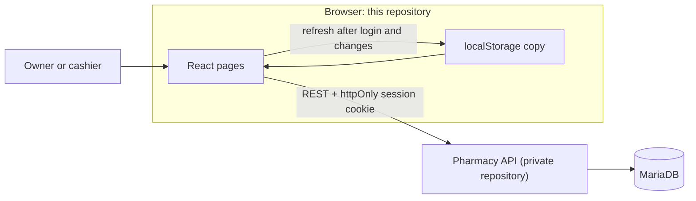

<p align="center">
  
</p>

<h1 align="center">Dagohoy Pharmacy Web</h1>

<p align="center">
  The browser app of the Dagohoy Pharmacy <b>Inventory &amp; Sales Record System</b>.<br>
  Stock by batch and expiry, the Sales Counter, shifts, credit (utang), expenses and owner reports, for one pharmacy in Bohol, Philippines.
</p>

<p align="center">
  
  
  
  
</p>

<p align="center">
  
  
</p>

<p align="center">
  <a href="#features">Features</a> ·
  <a href="#who-can-do-what">Roles</a> ·
  <a href="#a-day-at-the-pharmacy">Daily workflow</a> ·
  <a href="#architecture">Architecture</a> ·
  <a href="#getting-started">Getting started</a> ·
  <a href="#deployment">Deployment</a>
</p>

---

## Overview

A web app for one pharmacy, used by the owner (admin) and by cashiers who share one cashier login and type their names when they start a shift. Customers do not use it, apart from the public landing page with the store's opening hours.

The data lives on a separate API and database (a private repository). **This repository is the frontend only.**

> [!IMPORTANT]
> This is an **inventory and sales record system, not a POS**. The selling page is called the **Sales Counter**. Each sale is kept as an internal record shown on screen.
>
> - **No receipt is printed or given to customers.**
> - **Sales are never deleted.** A mistake is corrected with a void that records a reason.
>
> This follows the store's BIR decision. Do not add receipt printing or sale deletion without a new BIR accreditation decision.

## Features

### 🛒 Sales Counter

- **Barcode scanner ready.** A USB or Bluetooth scanner that types like a keyboard adds the item straight into the sale, with no clicking.
- **Forgiving search.** Word order, extra words and small typos still find the product, and a barcode match comes first. Typing never waits for the list.
- **Batch picking.** When a product's batches sell at different prices, each batch gets its own row, so the cashier chooses the batch and its price.
- **Sell by piece.** A tablet from a sachet, or a sachet from a box, at its own price.
- **Quantities** can be typed or changed with − / +, and never go above the stock.
- **Payment** by cash, GCash (with its reference), credit (utang) or no charge (with a reason); a discount in pesos.
- **Price check mode**, voids with a reason, and selling an item scanned before it was added to the product list (it then waits under _Not registered_).

### 🧾 Shifts and records

- Open a shift with the starting cash, record cash in and out, and close it with a drawer count; duty reports.
- Transactions list with the on-screen sales record, and credit (utang) accounts with payments.

### 📦 Products and stock

- Products with category, unit (_Sold per_), cost, price and optional selling by piece.
- _Needs price_, _Needs cost_ and _Not registered_ lists for items still missing details.
- Import from an Excel/CSV template; archive and restore; barcode lookup that fills in new products (when it is enabled on the API).
- **Receive deliveries** with batch, expiry, cost and selling price. Expiry is one _Day · Month · Year_ field everywhere; a blank day means the end of the month.
- Batches sell **first-expiry-first**. Expiry check, batch list, stock health, restock order, supplier returns and stock adjustments.
- Every stock change is kept in a ledger, so the history can always be traced.

### 📊 Owner reports and settings

| Report                 | What it answers                                                                                                       |
| ---------------------- | --------------------------------------------------------------------------------------------------------------------- |
| Profit                 | Did the store earn this month? Sales minus the cost of the items sold, expenses, free items and stock lost            |
| Stock value            | What the stock on hand cost, what it sells for, and the profit if all of it is sold                                   |
| Monthly sales          | Sales for each day of a month                                                                                         |
| Invoice guide          | Each day of sales laid out like a page of the store's BIR invoice booklet, so the booklet is copied from real numbers |
| Sales summary / weekly | The last 7 days at a glance                                                                                           |

Reports export to Excel or PDF. The owner also manages expenses, suppliers, the staff roster, accounts, store settings and opening hours, and sees the system subscription.

## Who can do what

| Area                                                                | Cashier login | Owner (admin) |
| ------------------------------------------------------------------- | :-----------: | :-----------: |
| Cashier dashboard, Sales Counter, shift, transactions, duty reports |      ✅       |      ✅       |
| Products, stock, suppliers, credit (utang)                          |      ✅       |      ✅       |
| Owner dashboard, expenses, reports                                  |               |      ✅       |
| Staff accounts and store settings                                   |               |      ✅       |

Products and stock are open to the cashier login so that daily work continues when the owner is away. Pages are guarded in the browser (`src/routes`), and the API checks the role again on every request.

## A day at the pharmacy

1. **Open the shift.** The cashier logs in, types the names of who is on duty, and counts the starting cash.
2. **Sell at the Sales Counter.** Scan or search each item, pick the batch if asked, take the payment. The sale is saved and the stock goes down at once.
3. **Receive deliveries** when they arrive: product, quantity, batch number, expiry, cost and selling price.
4. **Close the shift.** Count the drawer. The system compares the count with the recorded cash and asks for a note if they differ.
5. **The owner checks the reports** from anywhere: profit, stock value, items about to expire, and what to restock.

## Tech stack

| Area                 | Technology                                    | Role                                                                                   |
| -------------------- | --------------------------------------------- | -------------------------------------------------------------------------------------- |
| UI                   | React 19                                      | Landing page and the owner/cashier workspace                                           |
| Language             | TypeScript                                    | App code and API types                                                                 |
| Routing              | React Router 7                                | Public, cashier and admin routes, guarded by role                                      |
| Build                | Vite 7                                        | Dev server and the production bundle in `dist/`                                        |
| Server communication | `fetch` REST client (`src/services`)          | Calls the API with the session cookie                                                  |
| Browser copy         | `localStorage` (`src/data`)                   | Copies of products, stock and recent sales that the pages read; refreshed from the API |
| Files                | `read-excel-file`, `jspdf`, `html2canvas-pro` | Product import from Excel/CSV; Excel and PDF exports                                   |

## Architecture



- Pages and components are in `src/pages` and `src/components`.
- All API calls go through `src/services/storeApi.ts`.
- `src/data/serverSync.ts` refreshes the browser copies after login and after each sale or stock change. A sale never waits for that refresh.
- **The server is the source of truth.** A browser copy is only a cache, never the pharmacy's record.
- The session token is an httpOnly cookie. The app never keeps it in browser storage.

## Getting started

### Prerequisites

- **Node.js 22 or newer**, and npm. The project uses `package-lock.json`.
- **The companion API**, running and reachable. Login and every workspace page need it. The maintainer's full local setup (API, MariaDB, sample data) is in [Running locally](docs/RUNNING_LOCALLY.md).

### Install and run

```bash
npm install
cp .env.example .env
npm run dev
```

Open the address Vite prints, usually `http://localhost:5173`. The landing page is at `/`; **Log in** opens the workspace.

### Configuration

| Variable            | Kind               | Meaning                                            |
| ------------------- | ------------------ | -------------------------------------------------- |
| `VITE_API_BASE_URL` | Public, build time | API base URL. Default: `http://localhost:3001/api` |

The value is built into the web files, so each target (local, staging, live) needs its own build. See `.env.production.example`.

> [!WARNING]
> Never put a password, database setting or API key in a `VITE_` variable. Everything in it ends up in the web files, where anyone who opens the site can read it.

## Commands

| Command                | Purpose                                                 |
| ---------------------- | ------------------------------------------------------- |
| `npm run dev`          | Start the Vite dev server                               |
| `npm run build`        | Type-check, then build the production bundle in `dist/` |
| `npm run preview`      | Serve the built bundle locally                          |
| `npm run typecheck`    | TypeScript check only                                   |
| `npm run lint`         | ESLint                                                  |
| `npm run format:check` | Prettier check (`npm run format` fixes)                 |

This repository has no test suite. The business rules (sales, stock, voids, by-piece selling) are tested against a real database in the API repository.

## Project structure

```text
src/
├── components/   Shared UI, plus cashier, admin and landing-page parts
├── constants/    Navigation and app constants
├── data/         Browser copies, search ranking, batch pricing, server sync
├── layouts/      Public and workspace layouts
├── lib/          Excel, CSV, PDF and sound helpers
├── pages/        Landing, login, cashier and admin pages
├── routes/       Session and role guards
├── services/     REST API client
└── types/        Shared types
docs/             Running locally and deployment
```

## Deployment

The web app runs on Hostinger as a static Vite build, next to the API (a Node.js app) and a managed MariaDB database, all over HTTPS. The steps that worked are in [Deployment](docs/DEPLOYMENT.md).

> [!NOTE]
> On every web upload, check that the build preset is **Vite** and the entry file is **blank**. A wrong preset makes the build fail, although the previous version stays live.

## Documentation

- [Running locally](docs/RUNNING_LOCALLY.md): start the API, database and web on the maintainer's computer; backups and restore.
- [Deployment](docs/DEPLOYMENT.md): the Hostinger deployment as done on 2026-11-13, and how to update.

## License

Copyright © 2026 Niel Adrian. **All rights reserved.** The source is visible here for reference only. Copying, reuse or resale needs written permission. See [LICENSE](LICENSE).
