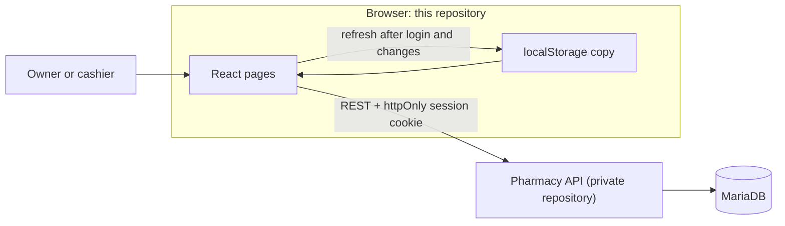

# Dagohoy Pharmacy Web

> The browser app of the Dagohoy Pharmacy **Inventory & Sales Record System**: stock by batch and expiry, the Sales Counter, shifts, credit (utang), expenses and owner reports.


## Overview

A web app for one pharmacy, used by the owner (admin) and by cashiers who share one cashier login and type their names when they start a shift. Customers do not use it, apart from the public landing page.

It is an **inventory and sales record system, not a POS**. The selling page is called the **Sales Counter**, and each sale is kept as an internal record shown on screen. **No receipt is printed or given to customers, and sales are never deleted**: a mistake is corrected with a void that gives a reason. This follows the store's BIR decision; do not add receipt printing or sale deletion without a new BIR accreditation decision.

The data lives on a separate API and database (a private repository). This repository is the frontend only.

## Tech stack

| Area                 | Technology                                    | Role                                                                                   |
| -------------------- | --------------------------------------------- | -------------------------------------------------------------------------------------- |
| UI                   | React 19                                      | Landing page and the owner/cashier workspace                                           |
| Language             | TypeScript                                    | App code and API types                                                                 |
| Routing              | React Router 7                                | Public, cashier and admin routes, guarded by role                                      |
| Build                | Vite 7                                        | Dev server and the production bundle in `dist/`                                        |
| Server communication | `fetch` REST client (`src/services`)          | Calls the API with the session cookie                                                  |
| Browser copy         | `localStorage` (`src/data`)                   | Copies of products, stock and recent sales that the pages read; refreshed from the API |
| Files                | `read-excel-file`, `jspdf`, `html2canvas-pro` | Product import from Excel/CSV; Excel and PDF exports                                   |

## Features

**Sales Counter (cashier)**

- Barcode scanner support: a USB or Bluetooth scanner adds the item straight into the sale, with no clicking.
- Forgiving product search: word order, extra words and small typos still find the product, and a barcode match comes first.
- Batches that sell at different prices appear one row per batch, so the cashier picks the batch and its price.
- Products sold by piece (a tablet from a sachet, a sachet from a box) at their own price.
- Quantities can be typed or changed with − / +, and never go above the stock.
- Payment by cash, GCash (with reference), credit (utang) or no charge (with a reason); a discount in pesos.
- Price check mode, voids with a reason, and selling an item scanned before it was added to the product list (it then waits under _Not registered_).

**Shifts and records**

- Open a shift with the starting cash, record cash in and out, and close it with a drawer count; duty reports.
- Transactions list with the on-screen sales record, and credit (utang) accounts with payments.

**Products and stock (owner)**

- Products with category, unit (_Sold per_), cost, price and optional selling by piece.
- _Needs price_, _Needs cost_ and _Not registered_ lists for items still missing details.
- Import from an Excel/CSV template; archive and restore; barcode lookup for new products (when enabled on the API).
- Receive deliveries with batch, expiry (one _Day · Month · Year_ field everywhere), cost and selling price; batches that sell first-expiry-first.
- Expiry check, batches, stock health, restock order, supplier returns and stock adjustments. Every stock change stays in a ledger.

**Owner reports and settings**

- Profit by month, **stock value** (cost, selling value and expected profit of the stock on hand), monthly sales, an invoice guide for copying the store's BIR invoice booklet, and 7-day sales; Excel and PDF exports.
- Expenses, suppliers, the staff roster with the shared cashier login and admin accounts, store settings and opening hours, and the system subscription page.

## Architecture



- Pages and components are in `src/pages` and `src/components`.
- All API calls go through `src/services/storeApi.ts`.
- `src/data/serverSync.ts` refreshes the browser copies after login and after each sale or stock change.
- The server is the source of truth. A browser copy is only a cache, never the pharmacy's record.
- The session token is an httpOnly cookie. The app never keeps it in browser storage.

## Getting started

### Prerequisites

- Node.js 22 or newer, and npm (the project uses `package-lock.json`).
- The companion API running and reachable. Login and every workspace page need it. The maintainer's full local setup (API, MariaDB, sample data) is in [Running locally](docs/RUNNING_LOCALLY.md).

### Install and run

```bash
npm install
cp .env.example .env
npm run dev
```

Open the address Vite prints (usually `http://localhost:5173`). The landing page is at `/`; **Log in** opens the workspace.

### Configuration

| Variable            | Kind               | Meaning                                            |
| ------------------- | ------------------ | -------------------------------------------------- |
| `VITE_API_BASE_URL` | Public, build time | API base URL. Default: `http://localhost:3001/api` |

The value is built into the web files, so each target (local, staging, live) needs its own build. See `.env.production.example`. Never put a password, database setting or API key in a `VITE_` variable, because everything in it can be read by anyone who opens the site.

## Commands

| Command                | Purpose                                                 |
| ---------------------- | ------------------------------------------------------- |
| `npm run dev`          | Start the Vite dev server                               |
| `npm run build`        | Type-check, then build the production bundle in `dist/` |
| `npm run preview`      | Serve the built bundle locally                          |
| `npm run typecheck`    | TypeScript check only                                   |
| `npm run lint`         | ESLint                                                  |
| `npm run format:check` | Prettier check (`npm run format` fixes)                 |

This repository has no test suite. The business rules (sales, stock, voids, by-piece selling) are tested in the API repository.

## Project structure

```text
src/
├── components/   Shared UI, plus cashier, admin and landing-page parts
├── constants/    Navigation and app constants
├── data/         Browser copies, search ranking, batch pricing, server sync
├── layouts/      Public and workspace layouts
├── lib/          Excel, CSV, PDF and sound helpers
├── pages/        Landing, login, cashier and admin pages
├── routes/       Session and role guards
├── services/     REST API client
└── types/        Shared types
docs/             Running locally and deployment
```

## Deployment

The web app runs on Hostinger as a static Vite build, next to the API (a Node.js app) and a managed MariaDB database, all over HTTPS. The steps that worked, including the build settings to check on every upload, are in [Deployment](docs/DEPLOYMENT.md).

## Documentation

- [Running locally](docs/RUNNING_LOCALLY.md): start the API, database and web on the maintainer's computer; backups.
- [Deployment](docs/DEPLOYMENT.md): Hostinger deployment as done on 2026-11-13, and how to update.

## License

Copyright © 2026 Niel Adrian. All rights reserved. The source is visible here for reference only; copying, reuse or resale needs written permission. See [LICENSE](LICENSE).
