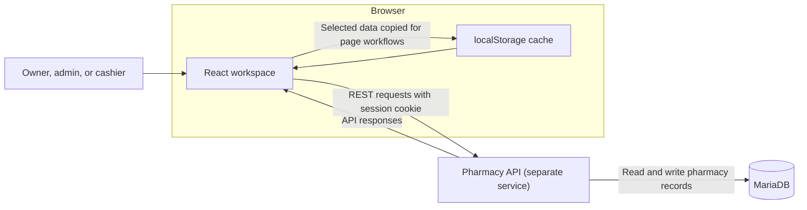

# Dagohoy Pharmacy Web

> A browser-based point-of-sale and pharmacy operations workspace for owners, administrators, and cashiers.


## Tech stack

| Area                  | Technology              | Role                                             |
| --------------------- | ----------------------- | ------------------------------------------------ |
| UI                    | React                   | Landing page and role-based workspace screens    |
| Language              | TypeScript              | Application and API types                        |
| Routing               | React Router            | Public, cashier, and admin routes                |
| Build and development | Vite                    | Local development server and production bundle   |
| Server communication  | Fetch-based REST client | Calls the separately operated pharmacy API       |
| Browser cache         | `localStorage`          | Holds client-side copies used by workspace pages |

## Overview

The web app provides a public pharmacy landing page and a staff workspace. After signing in, cashiers can use the sales counter, manage shifts and review transactions; owners and administrators also have access to inventory, staff, reports, expenses, credit accounts, and pharmacy settings.

The API is a separate service and is not included in this repository. The frontend sends authenticated requests to it and caches selected server data in the browser for existing page workflows. Some dashboard figures and inventory fallbacks are illustrative sample data; confirm a page's data source before using its figures operationally.

## Features

- Public pharmacy landing page and staff sign-in.
- Role-gated owner/admin and cashier workspaces.
- Point of sale with product search/barcode lookup, discounts, payment methods, receipt preview, and sale records.
- Shift opening and closing, cash events, shift history, and reports.
- Product catalog, batch and expiry views, stock receiving and adjustments, supplier records, and stock movement views.
- Owner tools for staff accounts, pharmacy settings, expenses, credit accounts, and sales reporting.
- Excel exports for transactions and shift reports; shift reports also support PDF preview/export.

Some screens contain sample or illustrative figures. Server-backed operations require the companion API to be available; see [Data and integration status](#data-and-integration-status).

## Architecture



The route and page UI lives in `src/pages` and `src/components`. API calls are centralized in `src/services`; `src/data/serverSync.ts` refreshes local browser copies after login and after selected changes. The diagram's API and database are external to this repository. The API client sends cookies with requests; it does not store the session token in browser storage.

## Getting started

### Prerequisites

- Node.js and npm.
- The companion pharmacy API running and reachable for sign-in and server-backed workspace features.

### Install and run

```bash
git clone https://github.com/adrianniel/Dagohoy-Pharmacy-Web.git
cd Dagohoy-Pharmacy-Web
npm install
cp .env.example .env
npm run dev
```

Open the local URL printed by Vite (typically `http://localhost:5173`). The root route displays the public landing page; use **Log in** to open the staff workspace. For the companion API and database setup used by the maintainer, see [Running locally](docs/RUNNING_LOCALLY.md).

### Configuration

`VITE_API_BASE_URL` sets the API base URL. It defaults to `http://localhost:3001/api` if omitted. The value is embedded in the frontend bundle at build time; create a separate build for each API environment. This is public client configuration—never put database passwords, API keys, or other server secrets in a `VITE_` variable.

For a production build, `.env.production.example` documents the expected setting format. The linked [deployment checklist](docs/DEPLOY_CHECKLIST.md) is explicitly a draft; it is not evidence that a production deployment has been completed or verified.

## Development commands

| Command                | Purpose                                                |
| ---------------------- | ------------------------------------------------------ |
| `npm run dev`          | Start the Vite development server                      |
| `npm run typecheck`    | Run the TypeScript project check                       |
| `npm run lint`         | Run ESLint                                             |
| `npm run format:check` | Check formatting with Prettier                         |
| `npm run build`        | Type-check and create the production bundle in `dist/` |
| `npm run preview`      | Serve the built bundle locally for preview             |

There is no frontend test script defined in `package.json`.

## Project structure

```text
src/
├── components/   Shared UI, cashier, admin, and landing-page components
├── constants/   Application and navigation constants
├── data/        Browser stores, account state, and server synchronization
├── layouts/     Public and cashier/admin workspace layouts
├── pages/       Landing, sign-in, cashier, and admin pages
├── routes/      Session and role route guards
├── services/    REST API clients
└── types/       Shared TypeScript types
docs/            Local development, implementation, and deployment notes
```

## Data and integration status

The frontend is configured to communicate with a separate API for authentication, products, sales, stock, shifts, suppliers, staff, settings, expenses, and related operations. The API/database are not part of this repository. Workspace routes check the server session, and the API client sends the session cookie with requests.

Selected API responses are copied into browser `localStorage` because some pages currently read from local stores. That cache is not the authoritative pharmacy record. Some dashboard content and fallback data remain illustrative; printed receipts are not a substitute for any legally required tax document. Do not assume a sample figure or a cached value has been verified against the live API.

## Further documentation

- [Running locally](docs/RUNNING_LOCALLY.md) — maintainer's companion API and database workflow.
- [Development playbook](docs/DEVELOPMENT_PLAYBOOK.md) — project development notes.
- [Implementation plan](docs/IMPLEMENTATION_PLAN.md) — documented implementation work.
- [Deployment checklist](docs/DEPLOY_CHECKLIST.md) — draft checklist; Hostinger deployment steps have not yet been verified.
